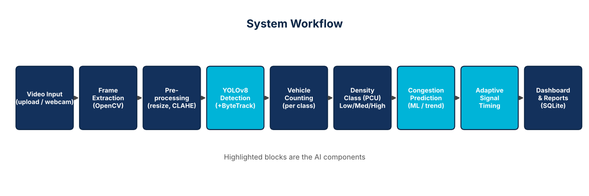

# AI-Powered Traffic Flow Optimization System

Upload road-traffic videos (or use a webcam) → **YOLOv8** detects and tracks vehicles → traffic **density** is classified
(Low / Medium / High) → a **machine-learning model predicts congestion** → an **adaptive signal-timing algorithm**
recommends green times → everything is shown on a web **dashboard**, stored in **SQLite**, and exportable as **PDF / CSV**.

> **Signal optimization is a software simulation.** Nothing here controls real traffic lights, and the
> waiting-time figures come from a simplified delay model — they are estimates, not field measurements.



## 1. Features → files

| Requirement | Where |
|---|---|
| Video upload / webcam / frame extraction | `app.py`, `modules/video_processor.py` (OpenCV) |
| YOLOv8 detection (car, bus, truck, motorcycle, bicycle) + boxes + counts | `modules/detector.py` |
| Density Low/Medium/High (passenger-car units) | `modules/density.py` |
| Congestion prediction (Gradient Boosting + trend fallback) | `modules/predictor.py` |
| Adaptive green timing, no starvation | `modules/signal_optimizer.py` |
| Dashboard & 7 pages | `templates/`, `static/` |
| SQLite history, PDF/CSV reports, Matplotlib charts | `modules/database.py`, `modules/reports.py` |
| Automated tests (16) | `tests/test_system.py` |

## 2. Requirements
* Windows 10/11 (Linux/macOS also work), **Python 3.9 – 3.12** (64-bit), ~3 GB free disk (PyTorch), internet for the *first* install/run.
* No GPU needed (`yolov8n` runs on CPU; expect a few analysed frames per second).

## 3. Install and run — Windows (VS Code)
1. Install **Python 3.11 or 3.12** from python.org (tick *“Add python.exe to PATH”*) and **VS Code** with the *Python* extension.
2. Unzip the project, then in VS Code: **File → Open Folder…** → select `traffic_ai`.
3. Open a terminal: **Terminal → New Terminal** (PowerShell) and run:
```powershell
python -m venv venv
venv\Scripts\Activate.ps1          # if blocked: Set-ExecutionPolicy -Scope CurrentUser RemoteSigned
python -m pip install --upgrade pip
pip install -r requirements.txt
python scripts\check_setup.py       # verifies packages + downloads yolov8n.pt (~6 MB)
python app.py
```
4. Press **Ctrl+Shift+P → “Python: Select Interpreter” →** choose `.\venv\Scripts\python.exe` (so VS Code uses the venv).
5. Open **http://127.0.0.1:5000**. *(Shortcut: double-click `run.bat` — does steps 3 and 5 automatically.)*

Linux/macOS: `python3 -m venv venv && source venv/bin/activate && pip install -r requirements.txt && python app.py`

> The pages load Bootstrap from a CDN, so the **browser** needs internet. Offline demo? Download
> `bootstrap.min.css/js` into `static/vendor/` and change the two links in `templates/base.html`.

## 4. Using the system (demo script)
1. **Upload** → give a session name, choose a video for each road (North/East/South/West; 2–4 recommended) → *Start analysis*.
2. **Dashboard** opens: processed video with boxes streams live, KPI cards update, signal plan appears (marked *provisional* until all roads finish).
3. **Density** page: per-road gauges, PCU, class counts, thresholds chart. **Prediction**: forecast ~10 s ahead, trend and the method used.
4. **Signals**: recommended green times, plus a **side-by-side queue simulation** (fixed equal timing vs adaptive) and a **what-if calculator** where you type vehicle counts.
5. **Reports**: history table, charts, peak-traffic snapshots, **PDF** and **CSV** download, delete a session.
6. **Live Detection**: webcam on the server PC; *Stop & save* stores the run in history.

## 5. Tests
```powershell
python -m unittest discover -s tests -v
```
16 automated tests cover density rules, the optimizer (invariants over 300 random cases, no-starvation), the predictor,
the database (including cascade delete and SQL-injection guard), upload validation, and the **full pipeline** (upload → processing →
prediction → signal plan → charts/PDF/CSV → delete). These tests substitute a simple contour-based detector for YOLO so they run
anywhere; the **real YOLO path is verified with the manual cases in `docs/TEST_CASES.md` (TC-20 …)** — please run them once on your laptop.

## 6. Sample data
* `sample_videos/synthetic_*.mp4` – **synthetic** moving boxes (generated by `scripts/make_sample_videos.py`). They prove the pipeline works but **YOLO normally will not detect cartoon boxes** (counts will be ~0). Use them only as a smoke test.
* **For real results use real traffic footage**:
  * Pexels (pexels.com/videos) or Pixabay (pixabay.com/videos): search *“traffic”, “highway traffic”, “intersection”, “aerial traffic”* – free to download. Choose a **fixed-camera** clip (not a moving one) of 20–60 s.
  * **UA-DETRAC** (detrac-db.rit.albany.edu) – standard fixed-camera vehicle-detection dataset (videos + annotations).
  * Kaggle: search *“traffic videos”* / *“vehicle detection dataset”*.
  * Only one video? `python scripts\split_video.py my_video.mp4 --parts 4` cuts it into 4 consecutive clips to use as N/E/S/W.
  * Different densities per road give the most convincing signal-timing demo (e.g. a busy clip for North, an almost-empty one for West).

## 7. Configuration (`config.py`)
`CONF_THRESHOLD` (detection confidence), `PROCESS_FPS` (analysed frames per video-second; lower = faster), `LOW_MAX_PCU` / `MEDIUM_MAX_PCU`
(density thresholds), `CYCLE_TIME`, `MIN_GREEN`, `MAX_GREEN`, `YELLOW_TIME`. Use `YOLO_MODEL=yolov8s.pt` (env var) for a more accurate, slower model.

## 8. Troubleshooting
| Problem | Fix |
|---|---|
| `pip install` fails for torch / long install | Use Python 3.11/3.12 64-bit; upgrade pip; retry. Install can take 5–10 min. |
| *Could not load YOLO weights* | First run needs internet to fetch `yolov8n.pt`. Offline: download it elsewhere and put it in `models/`. |
| Processing is slow | Lower `PROCESS_FPS` (e.g. 2), use shorter/smaller videos, upload fewer roads at once. |
| Video “could not be read” | Re-encode to H.264 MP4 (HandBrake / VLC) — some codecs are unsupported by OpenCV. |
| Counts are always 0 | You used the synthetic samples, or the vehicles are tiny/far. Use clearer footage; lower `CONF_THRESHOLD` to 0.25. |
| Webcam won’t open | Close Zoom/Teams/Camera app; try camera index 1; check Windows camera privacy settings. |
| Layout looks unstyled | Browser has no internet (Bootstrap CDN) – see note in §3. |
| `Activate.ps1 cannot be loaded` | `Set-ExecutionPolicy -Scope CurrentUser RemoteSigned`, or use `venv\Scripts\activate.bat` in cmd. |
| Port 5000 busy | Edit the port at the bottom of `app.py`. |
| “Unique vehicles tracked” shows *unavailable* | ByteTrack couldn’t start (missing `lap`). Run `pip install lap`; detection still works without it. |

## 9. Known limitations (be upfront in your viva)
* Counts are per analysed frame; **unique vehicles** come from ByteTrack IDs and can over-count when a vehicle is occluded and re-identified.
* Congestion prediction forecasts the *measured load* ~10 s ahead from short recordings; accuracy improves with more history for the same road.
* The delay model and queue simulator are simplified teaching models; they illustrate the benefit, they do not prove real-world gains.
* Built for a single-user local demo (Flask dev server, in-memory job state); not hardened for public deployment.

See `docs/DOCUMENTATION.md` for design details and `docs/TEST_CASES.md` for the test plan.
