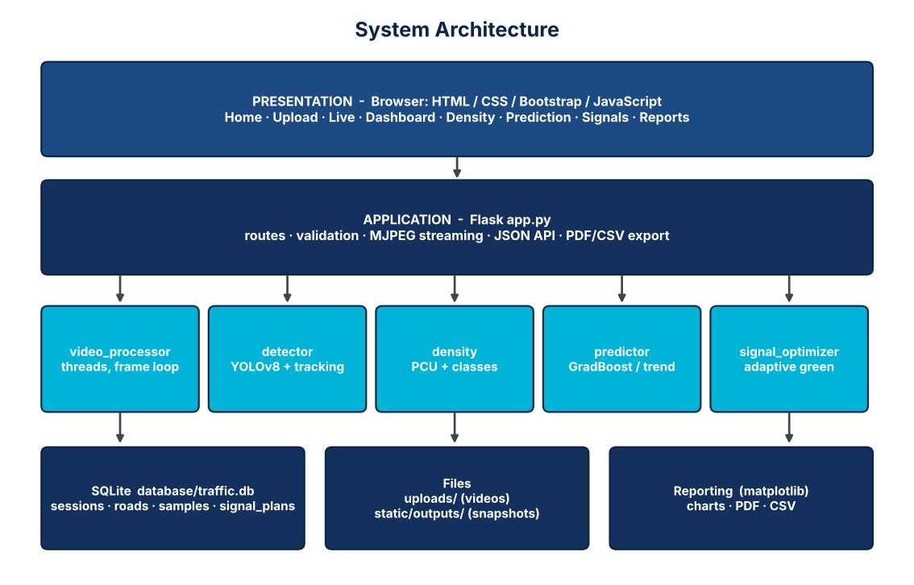
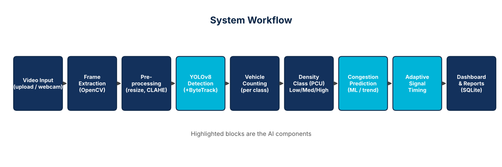

# Project Documentation — AI-Powered Traffic Flow Optimization System

## 1. Problem statement and objective
Fixed-time traffic signals give every approach the same green time regardless of demand, causing avoidable queues on busy roads and wasted green on empty ones.
This project measures real traffic from video with computer vision, predicts short-term congestion, and recommends demand-proportional green times,
demonstrated by software simulation.

## 2. Architecture

Layers: browser UI → Flask application → processing modules → SQLite/files/reports. A background thread per uploaded road
processes frames; the UI polls `/api/session/<id>/overview` every 1.5 s and shows the annotated video through an MJPEG stream (`/stream/road/<id>`).

## 3. Workflow

1. **Input** – upload (mp4/avi/mov/mkv/webm/m4v, validated by extension *and* by actually decoding a frame) or webcam.
2. **Frame extraction** – OpenCV `grab()` every frame, `retrieve()` every `fps/PROCESS_FPS`-th frame.
3. **Preprocessing** – resize to 640 px width; CLAHE contrast enhancement on the luminance channel.
4. **Detection** – YOLOv8n (COCO) restricted to bicycle, car, motorcycle, bus, truck, confidence ≥ 0.35; ByteTrack IDs give unique vehicle counts (automatic fallback to plain detection).
5. **Counting** – per-class counts per analysed frame.
6. **Density** – load in *passenger-car units* (car 1, motorcycle 0.5, bus/truck 2.5, bicycle 0.3); Low ≤ 8, Medium ≤ 18, High > 18 PCU.
7. **Prediction** – see §4.
8. **Signal timing** – see §5.
9. **Dashboard / reports** – KPI cards, per-road feeds, matplotlib charts, PDF (summary + 5 charts) and CSV.

## 4. Congestion prediction
* Samples → 2-second buckets (gaps forward-filled) → sliding windows of 6 buckets.
* Features: 6 lags, mean, std, slope, last–first. Target: PCU 5 buckets (~10 s) ahead.
* Model: `GradientBoostingRegressor(80 trees, depth 3)` trained on up to 10 earlier recordings of the same road (from SQLite) plus the current one, once ≥ 30 windows exist.
* Fallbacks: linear-trend extrapolation (≥ 3 buckets), persistence (< 3). While a video is still processing, the cheap trend method is used; the ML model runs on completed roads.
* Output: predicted PCU → Low/Medium/High, trend (Rising/Falling/Stable), method and confidence — always displayed so the method is transparent.

## 5. Signal optimization
Let *n* roads, cycle *C*, yellow *Y*, green budget *G = C − nY*, demand *dᵢ = PCUᵢ + 0.5*.
1. Proportional share *gᵢ = G·dᵢ / Σd*.
2. Iterative clamping to [`MIN_GREEN`, `MAX_GREEN`] (water-filling) → **no road starves** and no road monopolises the cycle.
3. Round to whole seconds and repair the sum so Σgᵢ = G exactly.
4. Phases run in fixed cyclic order (N → E → S → W), each with green + yellow; red = the remaining time.
5. Estimated mean wait per road (uniform arrivals) = red² / (2C); the weighted mean (by measured load) is compared with equal green splitting.

The *Signals* page also runs a one-second-step queue simulation of both plans with identical arrivals (75 % of capacity overall) to illustrate the effect.

## 6. Database schema (SQLite)
| Table | Purpose | Key columns |
|---|---|---|
| `sessions` | one analysis run | id, name, source (upload/webcam), created_at |
| `roads` | one video per road | session_id, road_name, status, avg/max PCU, class averages, unique counts, snapshot |
| `samples` | per analysed frame | road_id, t, total, pcu, level, per-class counts |
| `signal_plans` | final recommended plan | session_id, plan_json |

Foreign keys with `ON DELETE CASCADE`; only whitelisted columns can be updated; all queries are parameterised.

## 7. REST endpoints
`GET /api/session/<id>/overview` · `POST /api/simulate` · `POST /api/session/<id>/delete` · `GET /stream/road/<id>` · `GET /snapshot/<id>` ·
`POST /api/live/start|stop` · `GET /api/live/stats` · `GET /live_feed` · `GET /chart/<id>/<kind>.png` · `GET /report/<id>.pdf|.csv`

## 8. Error handling and validation
Extension whitelist + decode check on upload, 500 MB request limit (friendly redirect), unreadable/corrupt video → road marked *error* with message,
missing YOLO weights/package → clear instruction, webcam open failure → message, simulator input range-checked (0–500, ≥ 2 roads),
server restart marks unfinished roads *interrupted*.

## 9. Possible future work
Per-lane region-of-interest counting, line-crossing flow rates, LSTM forecasting with long recordings, emergency-vehicle priority, multi-junction coordination, integration with a traffic-signal simulator such as SUMO.
